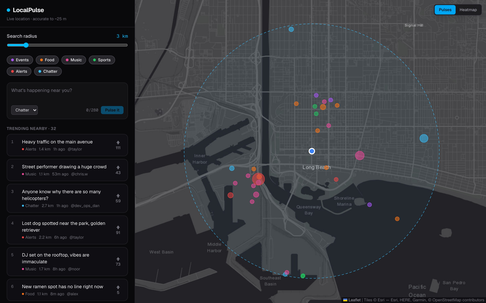
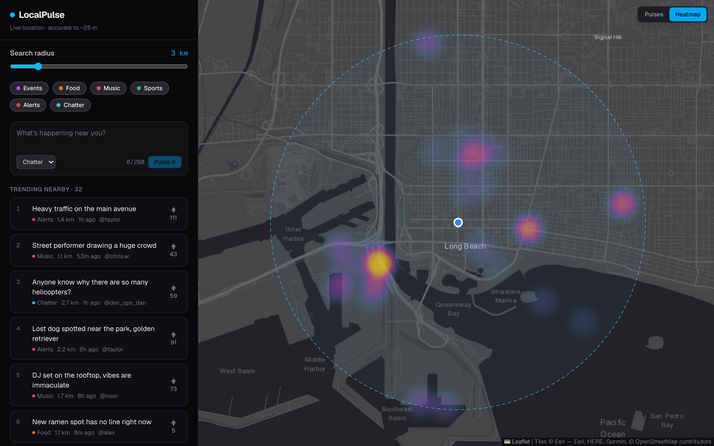
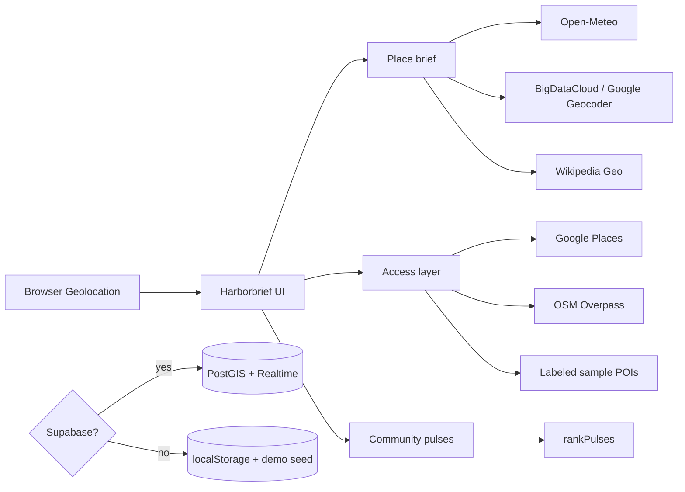

# Harborbrief · LocalPulse

[](https://github.com/dipak5501/localpulse/actions/workflows/ci.yml)
[](https://github.com/dipak5501/localpulse/actions/workflows/deploy.yml)

**A living brief for the ground under your feet.** Harborbrief is not another generic “local trending” map — it layers **live weather**, a **Wikipedia place story**, **neighborhood access** (clinics, pharmacies, groceries, transit, parks), and **community pulses** ranked by a location-aware trending algorithm.

Built by [Dipak Yadav](https://dipak5501.github.io/) (CSULB · Long Beach) — home port defaults to Long Beach when location is denied.

**[Live demo →](https://dipak5501.github.io/localpulse/)** · **[Long Beach deep link →](https://dipak5501.github.io/localpulse/?lat=33.77010&lng=-118.19370)**

| Pulses | Heatmap |
| ------ | ------- |
|  |  |

## What makes it uncommon

Most “local pulse” clones stop at pins + a feed. Harborbrief answers a different question:

> **What is this place telling you right now?**

1. **Living place brief** — reverse-geocoded neighborhood name, Open-Meteo conditions, nearest Wikipedia extract.
2. **Access layer** — health-equity-adjacent neighborhood amenities (care, Rx, groceries, transit, parks) from Google Places when a key is present, otherwise OSM Overpass, otherwise clearly labeled sample points.
3. **Community pulses** — the original LocalPulse ranking (upvotes × recency × proximity) with markers and a hand-rolled heatmap.

Repo / GitHub Pages path stays `localpulse` so existing links keep working; the product name in the UI is **Harborbrief**.

## Features

- **Live geolocation** via `watchPosition`, with Long Beach fallback + `?lat=&lng=` deep links
- **Place brief panel** assembled from independent public APIs (partial failure tolerant)
- **Three map modes:** Pulses · Heatmap · Access
- **Radius search** (1–15 km) with haversine locally, or PostGIS `ST_DWithin` via Supabase
- **Optional Google Maps Platform** — Geocoding + Places Nearby unlock richer names and reliable POIs
- **Offline pulse demo** when Supabase env is missing (seeded + `localStorage`)
- **Responsive and accessible** controls (`aria-pressed`, radiogroup, labelled inputs)

## APIs

| Signal | Default (no keys) | With `NEXT_PUBLIC_GOOGLE_MAPS_API_KEY` |
| ------ | ----------------- | -------------------------------------- |
| Place name | [BigDataCloud](https://www.bigdatacloud.com/) reverse-geocode client | Google Geocoding (Maps JS) |
| Weather | [Open-Meteo](https://open-meteo.com/) | same |
| Place story | [Wikipedia](https://www.mediawiki.org/wiki/API:Main_page) GeoSearch + REST summary | same |
| Access POIs | [Overpass](https://overpass-api.de/) (OSM); labeled **sample** points if Overpass is down | Google Places Nearby |
| Community pulses | Demo seed + `localStorage` | + Supabase when configured |

Demo / sample access points are always labeled in the UI — never presented as live OSM/Google data.

## Enable Google Cloud API key

1. Open [Google Cloud Console](https://console.cloud.google.com/) → create or select a project.
2. Enable billing (Maps Platform requires it; free monthly credit usually covers light demos).
3. **APIs & Services → Enable:** Maps JavaScript API, Places API, Geocoding API.
4. **Credentials → Create credentials → API key.**
5. Restrict the key:
   - **Application:** HTTP referrers — `http://localhost:3000/*`, `https://dipak5501.github.io/*`
   - **API restrictions:** the three APIs above
6. Copy into `.env.local` as `NEXT_PUBLIC_GOOGLE_MAPS_API_KEY=…` (see [`.env.example`](.env.example)).
7. For GitHub Pages, add the same value as repository secret `NEXT_PUBLIC_GOOGLE_MAPS_API_KEY` and re-run Deploy.

Never commit real keys. The anon/browser key is safe only when referrer-restricted.

## How trending works

```
score = (upvotes + 1) / (ageHours + 2) ^ 1.5  ×  (1 − 0.5 × min(distance / radius, 1))
```

Implementation: [`src/lib/trending.ts`](src/lib/trending.ts).

## Architecture



## Database (Supabase + PostGIS)

Unchanged dual backend: when `NEXT_PUBLIC_SUPABASE_URL` + `NEXT_PUBLIC_SUPABASE_ANON_KEY` are set, pulses go live with anonymous auth + Realtime. Otherwise the Pages demo stays on seeded data + `localStorage`. See [`supabase/`](supabase/) and the setup steps in prior releases (Anonymous provider, `db push`).

## Testing

| Layer | Tooling | Coverage |
| ----- | ------- | -------- |
| Unit | Vitest | Geo, trending, heatmap, storage, weather labels, access demo seed, Supabase gate |
| Database | Vitest + PGlite/PostGIS | Radius RPCs, votes, RLS |
| E2E | Playwright | Location, radius, filters, post/upvote, heatmap, Long Beach fallback |

## Tech stack

Next.js 16 · React 19 · TypeScript · Tailwind CSS 4 · Leaflet · Open-Meteo · Wikipedia · Overpass · optional Google Maps JS (Geocoding + Places) · optional Supabase · Vitest · Playwright · GitHub Actions

## Getting started

```bash
npm install
cp .env.example .env.local   # optional keys
npm run dev                  # http://localhost:3000
npm test
npm run test:e2e
npm run lint
npm run typecheck
npm run build
```

## Roadmap

- [x] Map, geolocation, radius, trending, heatmap, offline demo
- [x] Supabase + PostGIS + Realtime path
- [x] Harborbrief place brief (weather · wiki · geocode)
- [x] Access map mode (Google Places / Overpass / labeled demo)
- [ ] Photo attachments via Supabase Storage
- [ ] Optional Google Map tiles when a key is present
